# Rationale for Admission-Control Parameter Choices

## 1. Objective

This report motivates the choice of parameter values for the registrar-side admission protocol used for topic advertisement registration. The admission protocol regulates access to a finite advertisement cache (ad cache). Besides keeping the cache below its capacity, it decides *how to prioritise* registrations when admitting them to the cache by imposing *waiting times* on the registration requests. The waiting time is the delay a request must wait before its ad is stored in the ad cache.

The waiting time for each registration request is determined by a function w(ad) which computes a waiting time for each request that asks to register an ad. Each ad has attributes service and IP, where ad.IP is the IP address of the advertiser (the node requesting its ad to be registered) and ad.service is the name of the service being registered. The function is built on an occupancy-dependent base time b:

$$
b = W_{\mathrm{base}} \cdot \frac{E}{(1 - c/C)^{P_{\mathrm{occ}}}}
$$

$$
w(ad) = b \cdot \frac{c(ad.\mathrm{service})}{c + 1} + b \cdot \mathrm{score}(ad.\mathrm{IP}) + b \cdot G
$$

c is the number of ads currently stored in the cache, and c(ad.service) is the number of ads stored for the service that the request wants to register. score(ad.IP) is the IP-diversity score: the fraction of evaluated prefix levels of the advertiser's IP address that are more populated in the cache than a balanced distribution would allow.

The registrar applies the function with the following rules:

- Lower bounds: when the registrar quotes a waiting time, it records the service term for the topic and the IP term for the advertiser's IP prefix. A later request for the same topic or prefix is charged at least the recorded value minus the time elapsed since it was recorded, so a request cannot obtain a smaller quote by asking again. A topic's bound is dropped when the topic's last ad leaves the cache, and an IP bound disappears when its prefix leaves the IP tree. The G term has no bound.
- Tickets: every quote comes with a ticket. An advertiser that returns with its ticket when the quoted time has passed is credited the time it has waited since its first attempt, so the waiting time accumulates across retries.
- Admission: a request is admitted when its remaining wait is at most 1 s. A full cache quotes the 24 h cap minus the credited waiting time; only a request whose credited wait is within 1 s of the cap is told to come back when the next ad expires.
- Cap: quotes are capped at 24 h. When the cache is full the base time is unbounded, so a new request is quoted the cap.
- Expiry: expired ads are removed before a request is evaluated, so they neither count towards c nor make an advertiser look registered.

The parameters considered in this report are:

| Parameter | Meaning | Value |
|---|---:|---:|
| `E` | Advertisement lifetime | `900s` |
| `C` | Advertisement cache capacity | `1000` entries |
| `Pocc` | Occupancy exponent | `10` |
| `Wbase` | Base-time scale | `0.1` |
| `G` | Small safety constant in the waiting-time expression | `1e-7` |

These are the values in the [waiting-time function of the theory document](./discv5-theory.md#waiting-time-function). This report describes what single-registrar workloads say about them.

The admission waiting-time expression contains three conceptually distinct components: an occupancy term, a topic-similarity term, and an IP-diversity term. The occupancy term makes admission more conservative as the cache fills. The topic-similarity term discourages a single service topic from dominating the cache. The IP-diversity term discourages many registrations from the same or similar IP prefixes. The parameter rationale therefore has to answer two questions simultaneously: first, whether the cache remains usable for honest advertisers; second, whether the mechanism prevents cheap cache capture by abusive advertisers.

Security is a first-order design requirement in the admission protocol. In the absence of a reliable way to distinguish honest nodes from attackers in a permissionless setting, the admission protocol treats diversity of advertised services and network locations (IPs) of advertisers as the main locally observable signal for limiting cache capture. We aim to choose appropriate parameters in the waiting-time function to achieve diversity.

A parameter value that maximises ad cache utilisation but allows attackers to dominate admitted advertisements is not acceptable. At the same time, parameters that minimise attacker cache share by making the registrar largely unusable by honest nodes are also undesirable. The values below are therefore discussed as operating points in a trade-off between attack resistance, honest registration delay, and cache utilisation.

## 2. Attack models used for parameter selection

The admission protocol is evaluated against two attack models. These represent two different ways in which a finite registrar cache can be exploited.

### 2.1 Target-topic starvation attack

In a target-topic starvation attack, the attacker repeatedly registers advertisements for a single target topic. The attacker's objective is to dominate the registrar's entries for that topic, thereby excessively delaying or preventing honest registrations for the same topic and biasing topic lookup results towards attacker-controlled advertisements.

In the target-topic experiments, 50% of honest registrations use the target topic and the remaining honest registrations are distributed over other topics. The attackers register ads for only the target topic.

### 2.2 Cache occupation attack

In a whole-cache occupation attack, the attacker spreads registrations over many (random) topics. The objective is to consume registrar ad cache capacity. Imposing IP diversity makes this attack more difficult (i.e., costly), as advertisers must register ads from diverse IP addresses.

## 3. Evaluation questions

The evaluation is organised around five questions. Each question is associated with a specific parameter or mechanism component.

| Question | Purpose |
|---|---|
| Q1. How does `Pocc` affect cache protection versus honest delay? | Choose an occupancy exponent that gives a useful security/utilisation trade-off. |
| Q2. How large does the `ad cache` need to be to avoid honest starvation? | Choose an appropriate cache capacity `C`. |
| Q3. Does IP-diversity scoring reduce attacker cache share and honest starvation? | Justify the IP-diversity component. |
| Q4. What is the single-registrar cost of topic similarity for popular honest topics? | Measure the benign cost of the topic-similarity component. |
| Q5. How effective is admission control as attacker intensity increases? | Test robustness under stronger attacks with the default parameters fixed. |

## 4. Simulator and experimental setup

The experiments use a discrete-event simulator of a single registrar. The simulator models honest and attacker registration arrivals, registration attempts, waiting-time responses, retries, cache admission, advertisement expiry, renewal, and periodic metric sampling. Simulation time advances from event to event rather than in fixed time steps.

The registrar in the simulator is a Python port of the TopDisc registrar in datahop/go-ethereum (topdisc branch, commit 703d5a2b9): the waiting-time function of §1 with `Wbase = 0.1` and the `c + 1` denominator, the per-topic and per-prefix lower bounds, tickets that carry the waiting credit, the 1 s admission slack, the 24 h cap, and the IP prefix tree used for the diversity score, with counters kept at insertion depth and LAN addresses left unscored (the honest input holds no LAN addresses, so this exemption is not exercised). An advertiser that receives a quote waits for the quoted time and retries with its ticket. By default every advertiser, honest or attacker, waits out every quote. In the cases tested this is the better strategy for an attacker: concentrated attackers that follow the client's budget instead hold 6% of the cache rather than 40% (§9.4). §9.4 repeats the main cases with honest advertisers that give up when a quote exceeds the client's budget of 1.5·E, which moves the attacker's share by 9 to 14 percentage points.

What the simulator does not model: there is one registrar and no network, so there is no registrar selection by the advertiser, no topic search, and no message loss or latency. An advertiser that a registrar delays for hours would, in a deployment, register elsewhere; here it keeps waiting at the one registrar, and this evaluation gives no estimate of how much that changes the outcome. The simulator is IPv4 only, so the IPv6 tree and the rule taking the larger of an advertisement's two address-family scores are not exercised. Renewals arrive exactly when an ad expires. The results therefore measure how one registrar's cache is shared, not how well a topic can be found in the network; §6.4 gives the one network-level comparison available for `C`.

The delay reported for a registration is the end-to-end delay from the first registration attempt to admission, including all retries. When renewal is enabled, an admitted advertisement attempts to renew after expiry, so the system models persistent demand rather than isolated one-shot registrations.

Unless otherwise stated, the experiments use the following default configuration and parameters:

| Quantity | Value |
|---|---:|
| Runtime | `86400s (24h)` |
| Advertisement lifetime `E` | `900s` |
| Cache capacity `C` | `1000` |
| Occupancy exponent `Pocc` | `10` |
| Base-time scale `Wbase` | `0.1` |
| Safety constant `G` | `1e-7` |
| Honest registration rate | `0.05/s` |
| Attacker registration rate | `0.2/s` |
| Honest topics | 300, uniform |
| Attacker topics (cache occupation) | 300 (10,000 in Q3) |
| Attacker IP concentration | `/24` unless varied |
| Starvation threshold | `1800s = 2E` |
| Seeds | 1, 2, 3 |

A registration is classified as starved if it is not admitted within `2E = 1800s`. This threshold is an evaluation convention, not a protocol rule. It captures requests that remain pending across more than one expiry cycle. Each registration is renewed (by sending a new request) as soon as its lifetime expires.

The main metrics are attacker cache share, honest 95th percentile (p95) registration delay, target-topic honest p95 registration delay, cache utilisation, attacker attempts per admission, and honest starvation rate. Delay percentiles and the starvation rate count only requests that were admitted; a request still waiting when the 24 h run ends is in neither. Where this matters, the text also gives the fraction of new honest requests (renewals excluded) admitted within the run. Every figure shows the mean over the three seeds, with the shaded band spanning the lowest and highest seed.

Honest advertiser IP addresses are sampled from the public Ethereum discovery DNS node-list dataset rather than selecting honest IPs uniformly at random. We use the `all.json` file in the [`ethereum/discv4-dns-lists`](https://github.com/ethereum/discv4-dns-lists) repository at commit `cd92276` (30,053 node records). The repository contains EIP-1459 node lists built by the go-ethereum `devp2p` tool, and `all.json` contains the crawl output of nodes found through the Ethereum discovery DHT.

An earlier version of this report used a different waiting-time function, w(ad) = E/(1 − c/C)^Pocc · (c(ad.service)/c + score(ad.IP) + G), with `C = 1000`, and a registrar without lower bounds or tickets whose quotes were capped at E. The simulator, run scripts and per-seed results are in [datahop/topdisc-admission-sim](https://github.com/datahop/topdisc-admission-sim): `report/run.py` runs the grid, `report/figures.py` draws the figures, `report/data/*.csv` holds the per-seed rows and `report/REPORT-NOTES.md` maps each figure to its experiment. Running that earlier registrar in place of the current one reproduces the earlier figures with the same simulator and inputs: cache shares and utilisation within about 2 percentage points, starvation rates within 4 points, and delays within about 20%. Both versions use `C = 1000`, so the differences between the two versions of the figures come from the registrar, not from the workload or the cache size.

## 5. Q1: Choosing the occupancy exponent `Pocc`

### 5.1 Why Pocc matters

The occupancy exponent determines how rapidly admission becomes conservative as the registrar cache fills. It is therefore the main parameter controlling how strongly the registrar reacts to load. A small `Pocc` keeps the registrar permissive, which may improve utilisation but makes the cache easier to fill. A large `Pocc` can reduce attacker cache share, but may also leave the cache under-utilised and increase honest registration delay.

The role of `Pocc` in reducing attacker cache share comes from the structure of the waiting-time function. The topic-similarity and IP-diversity terms identify registrations that resemble advertisements already present in the cache, and these terms are multiplied by the base time b, which contains the occupancy factor:

$$
\frac{1}{(1 - c/C)^{P_{\mathrm{occ}}}}
$$

Thus, `Pocc` controls how much the registrar amplifies topic and IP diversity penalties as the cache approaches capacity. When the cache is lightly occupied, even similar registrations may receive modest waiting times. When the cache is heavily occupied, the same similarity score can result in a much larger delay. In this sense, `Pocc` determines how aggressively the protocol turns local diversity signals into admission resistance under load.

The purpose of this experiment is to identify a reasonable operating point in the trade-off between cache protection, honest delay, and utilisation. `Pocc` is varied over 1, 2, 4, 6, 8, 10, 12, 16, 20, 24 and 32 under the two attack scenarios. The occupancy-only baseline computes the waiting time from the occupancy component alone (b · G), with no topic or IP diversity penalties.

### 5.2 Cache-occupation attack

<table>
  <tr>
    <td align="center" width="50%">
      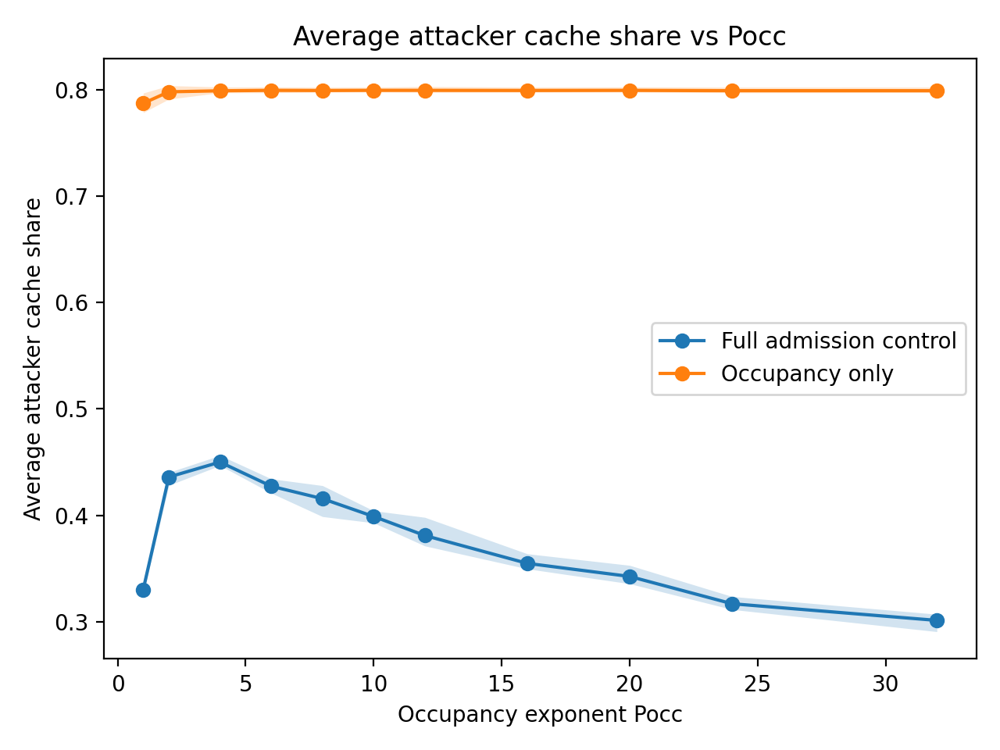
       
      <strong>Figure 1.</strong> Attacker cache share under the cache-occupation attack.
    </td>
    <td align="center" width="50%">
      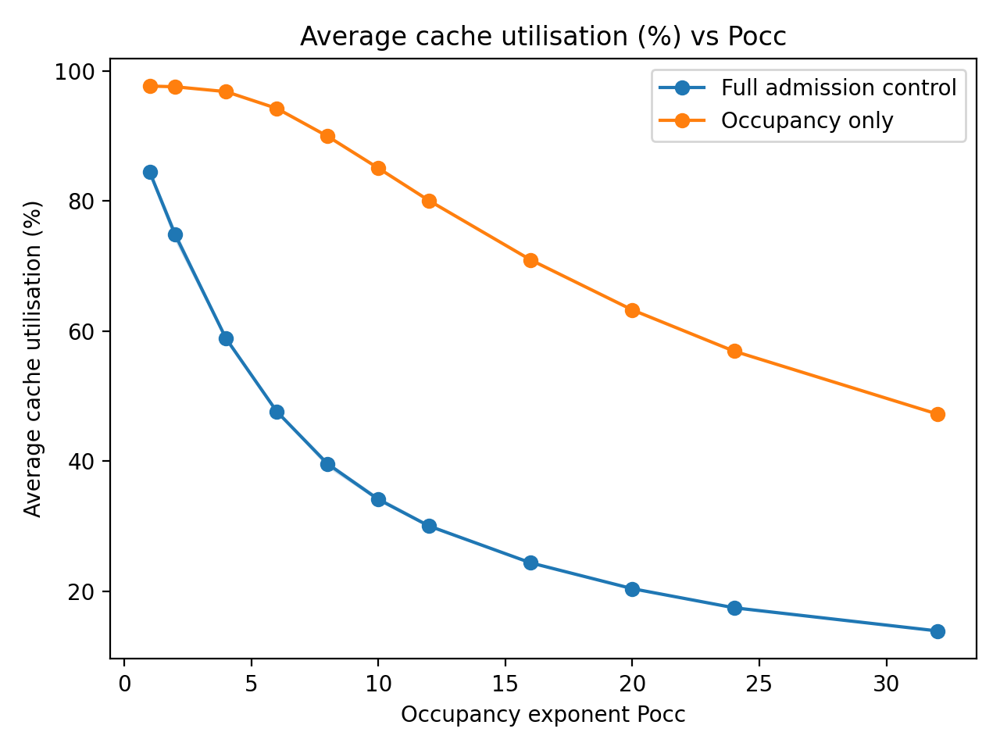
       
      <strong>Figure 2.</strong> Average cache utilisation under the cache-occupation attack.
    </td>
  </tr>
</table>

Under the cache-occupation attack, attacker cache share does not fall steadily with `Pocc`. With full admission control the attacker occupies 33% of the cache at `Pocc = 1`, rises to 45% at `Pocc = 4`, and then falls to 40% at `Pocc = 10` and 30% at `Pocc = 32`: about one percentage point per unit of `Pocc` from 4 to 12, more slowly after that. Only `Pocc` values of 24 and 32 give a lower attacker share than `Pocc = 1`.

The occupancy-only baseline does not provide comparable protection. Attacker share stays at 79 to 80% across the tested range, which matches the honest to attacker request-rate ratio of 1:4.

Above `Pocc = 4` the lower attacker share is accompanied by reduced utilisation. With full admission control, average utilisation is 84% at `Pocc = 1`, 34% at `Pocc = 10`, and 14% at `Pocc = 32`. Honest p95 registration delay rises from 8,189 s at `Pocc = 1` to 18,636 s at `Pocc = 10` and 31,796 s at `Pocc = 32`. Very high `Pocc` values therefore protect the cache by making the registrar much more selective, but they also leave most of the cache unused and lengthen honest waits.

### 5.3 Target-topic attack

<table>
  <tr>
    <td align="center" width="50%">
      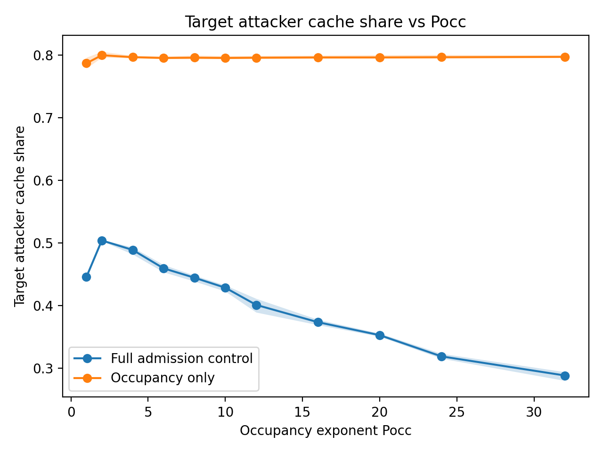
       
      <strong>Figure 3.</strong> Target-topic attacker cache share as <code>Pocc</code> varies.
    </td>
    <td align="center" width="50%">
      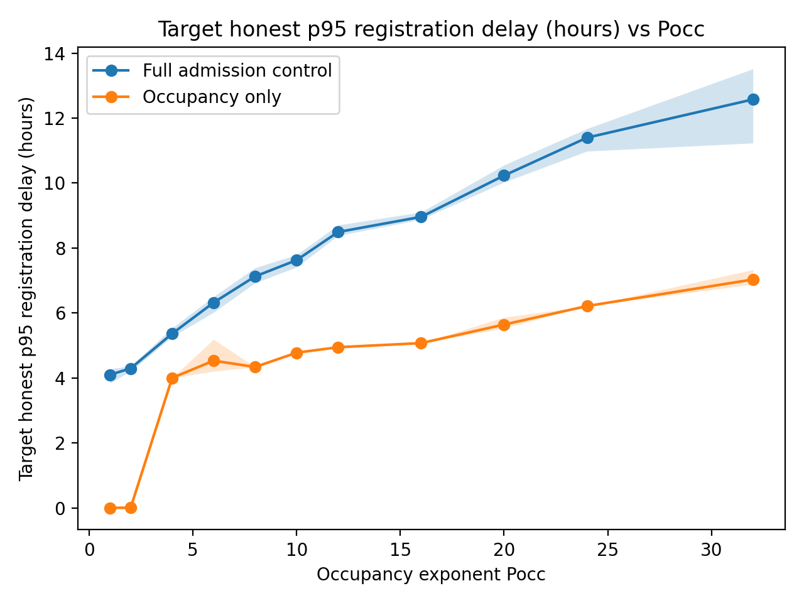
       
      <strong>Figure 4.</strong> Target-topic honest p95 registration delay as <code>Pocc</code> varies.
    </td>
  </tr>
</table>

The target-topic attack shows a similar pattern. With full admission control, the attacker's target-topic ads make up 45% of the cache at `Pocc = 1`, 50% at `Pocc = 2`, 43% at `Pocc = 10`, and 29% at `Pocc = 32`. With occupancy-only admission, the attacker stays at about 80% of the cache. The diversity terms are therefore what keeps repeated registrations for one topic from taking most of the cache, although at `C = 1000` the attacker still holds 43% of it at the default `Pocc`. Within the target topic itself, attackers hold 75% of the ads at `Pocc = 10`.

  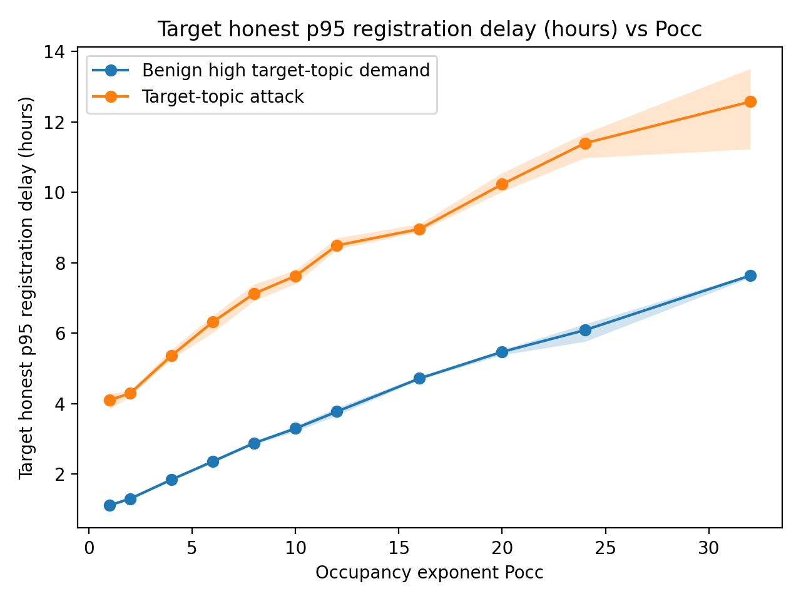

**Figure 5.** Target-topic honest p95 registration delay when 50% of honest registrations use the target topic, with and without a target-topic attacker.

The cost of higher `Pocc` is increased delay for honest target-topic registrations. With full admission control, target-topic honest p95 delay increases from 14,752 s (4.1 h) at `Pocc = 1` to 27,456 s (7.6 h) at `Pocc = 10` and 45,272 s (12.6 h) at `Pocc = 32`. Larger `Pocc` values do not give a free security improvement. The occupancy-only line in Figure 4 is lower (4.8 h at `Pocc = 10`) because it applies neither diversity penalty. Below `Pocc = 4` that line is in different regimes and not comparable with the rest. With one slot free, b · G is 0.009 s at `Pocc = 1`, below the 1 s slack, and 9 s at `Pocc = 2`; from `Pocc = 4` it exceeds E, and the cache settles ten or more slots below full, where quotes are of the order of E. At `Pocc = 1` the cache therefore fills, a full cache quotes the 24 h cap, and only 5% of new honest requests are admitted; the zero p95 counts only those admitted at once. That zero also depends on renewals in this simulator arriving exactly when their own ad expires, so that they take the freed slot immediately. At `Pocc = 2` the p95 of 9 s is the quote for the last free slot.

In the above target-topic delay results, the attacked topic is also a popular honest topic: 50% of honest registrations advertise the same service. Honest advertisers for the target topic therefore contend not only with the attacker but also with each other under the topic-similarity term. Figure 5 separates the two effects by comparing the target-topic attack with an otherwise identical benign workload in which 50% of honest registrations use the target topic but no attacker is present. At `Pocc = 10` the benign workload gives a target-topic p95 of 11,860 s (3.3 h), against 27,456 s under attack, so the attack raises the p95 more than twofold. Most of the benign delay is not caused by the topic being popular: with no popular topic at all, the honest p95 is already 9,940 s (§5.4).

### 5.4 FIFO baseline

The above comparison does not yet tell us whether the waiting times are caused simply by finite cache capacity or by the admission-control function itself. To separate these effects, we introduce a FIFO cache baseline. The FIFO baseline uses the same cache capacity `C = 1000`, advertisement lifetime `E = 900s`, honest request rate, and renewal behaviour, but removes the waiting-time function. Requests are admitted in arrival order whenever cache space is available. FIFO therefore represents the delay we would expect from capacity pressure alone, without diversity-based admission control.

Both the FIFO baseline and the admission-control curve in this comparison use the same honest-only workload. There is no attacker in this experiment. The comparison therefore isolates the cost introduced by the admission-control waiting-time function itself, rather than the additional delay caused by adversarial traffic.

  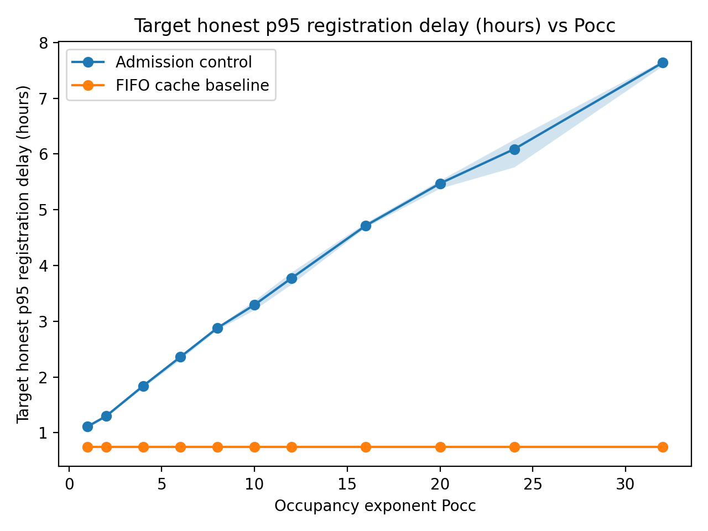

**Figure 6.** Target-topic honest p95 registration delay under an honest-only workload where 50% of honest registrations use the target topic. The FIFO baseline uses the same cache capacity and advertisement lifetime, but admits requests in arrival order rather than applying the admission waiting-time function. At `C = 1000` this workload fills the cache, so FIFO requests wait for a free slot.

At `C = 1000` the honest-only workload fills the cache: about 4,300 honest advertisers arrive within 24 hours, each keeping one ad, and FIFO utilisation averages 88%. FIFO gives a target-topic p95 of 2,696 s (0.75 h), the delay caused by capacity alone. (At `C = 5000` the same workload never fills the cache and FIFO admits every request on arrival.) Admission control produces a target-topic honest p95 delay that grows with `Pocc`, from 4,000 s (1.1 h) at `Pocc = 1` to 11,860 s (3.3 h) at `Pocc = 10` and 27,492 s (7.6 h) at `Pocc = 32`. At `Pocc = 10` the waiting-time function therefore adds about 2.5 h to what a full cache costs alone. Most of the delay is present without the topic term: with the topic score off, the target-topic p95 is still 9,901 s of the 11,860 s. With uniform topics the honest p95 is 9,940 s with both diversity terms, 7,431 s with the IP score off, and 3,343 s with both off, so both terms contribute. The honest IP addresses from the crawl are not spread evenly over the address space, so honest advertisers receive IP penalties too. At 50% target demand, turning the IP score off does not remove the delay but raises the target-topic p95 to 39,688 s (11 h): without the IP term more ads are admitted (49% utilisation against 29%), which makes b larger and the topic term for the popular topic heavier. The two terms interact through occupancy, so their delays do not add.

### 5.5 Implication for parameter choice

`Pocc` is the main lever on the trade-off, and at `C = 1000` the curves do not single out `Pocc = 10`. Between `Pocc = 6` and `Pocc = 16`, attacker cache share falls by 7 percentage points (43% to 35%), while utilisation falls by 23 points (48% to 24%) and honest p95 delay under attack rises by 2.0 h (15,166 s to 22,501 s). `Pocc = 10` sits in the middle of that range, and a neighbouring value would trade a few points of attacker share against utilisation and delay in the same proportion.

Low values give comparable protection at `C = 1000`. At `Pocc = 1` under cache occupation the attacker holds 33% of the cache against 40% at `Pocc = 10`, with utilisation of 84% against 34%, honest p95 delay of 8,189 s against 18,636 s, and 95% of new honest requests admitted against 83%. Under the target-topic attack, `Pocc = 1` gives the attacker 2 points more of the cache (45% against 43%) but nearly halves the target-topic honest p95 (4.1 h against 7.6 h); with no attacker that p95 is 1.1 h against 3.3 h. `Pocc = 1` was tested only with advertisers that wait out their quotes, at one registrar. Its cache runs close to full (84% on average), and how it behaves when advertisers give up, or across registrars, is not measured here.

With `Wbase = 0.1`, the `c + 1` term and the current registrar mechanisms, the original report's argument for `Pocc = 10`, a point on a curve that protects the cache more as `Pocc` grows, therefore holds only above `Pocc = 4`. `Pocc` stays at 10 as the value in the theory document; these results do not establish it over lower values.

The experiment also clarifies the role of the diversity terms. Occupancy alone prevents unconstrained growth, but it does not prevent attacker dominance: the attacker's share then equals its share of requests. The full formula is needed because the problem is not only how full the cache is, but also what composition the cache has under adversarial load.

At `C = 1000` the FIFO comparison separates capacity from the waiting-time function: a full cache alone gives a target-topic p95 of 0.75 h, and the function brings it to 3.3 h at `Pocc = 10`. Without an attacker and with uniform topics, both diversity terms contribute to the honest p95 delay (§5.4), and occupancy alone still gives 3,343 s. For a popular topic the two terms interact. This is an intentional design trade-off, but it also means that `Pocc` should not be set too high.

## 6. Q2: Choosing the cache capacity `C`

### 6.1 Why this question matters

The cache capacity `C` determines the number of ads that can be stored in the registrar. It is tempting to treat a larger cache as always better because it gives more space to honest advertisers. However, capacity also changes the security regime. A larger cache reduces scarcity pressure, which can lower honest delay but also allow attackers to maintain more entries.

The purpose of this experiment is to determine how capacity affects honest delay and attacker cache share when the rest of the admission protocol is fixed at its default operating point. `C` is varied over 100, 250, 500, 1000, 2000 and 5000.

### 6.2 Cache-occupation attack

<table>
  <tr>
    <td align="center" width="50%">
      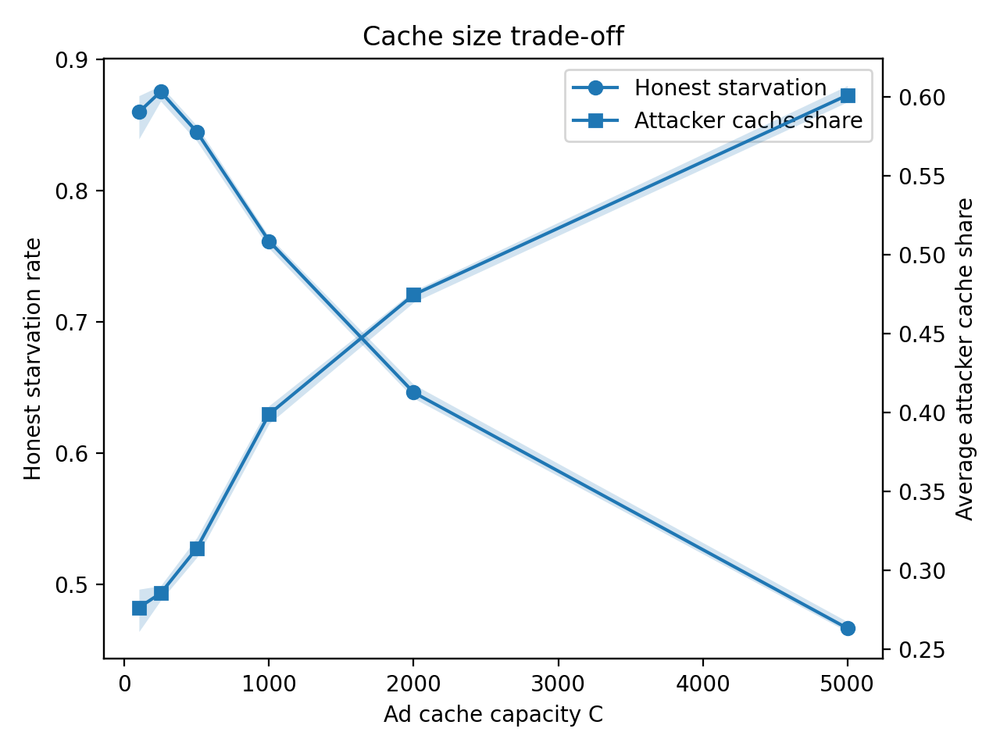
       
      <strong>Figure 7.</strong> Capacity trade-off under cache occupation. Starvation counts admitted requests only.
    </td>
    <td align="center" width="50%">
      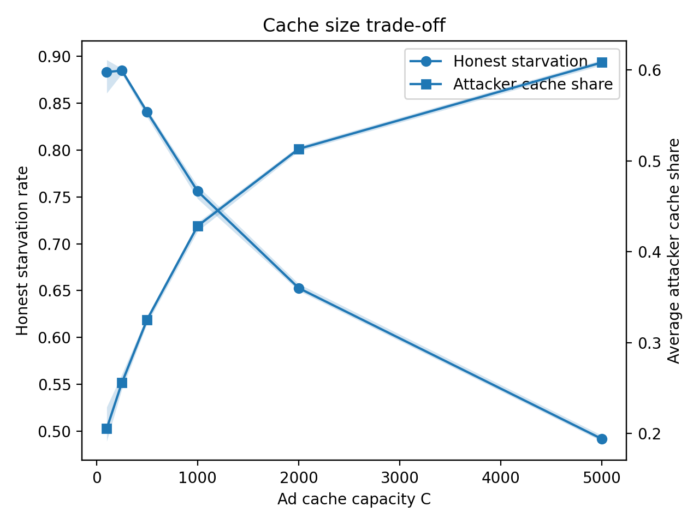
       
      <strong>Figure 8.</strong> Capacity trade-off under target-topic attack. Starvation counts admitted requests only.
    </td>
  </tr>
</table>

Under cache occupation, increasing `C` reduces honest delay. Honest p95 delay falls from 51,911 s at `C = 100` to 26,392 s at `C = 500`, 18,636 s at `C = 1000`, 12,131 s at `C = 2000`, and 5,877 s at `C = 5000`. The honest starvation rate falls from 86% at `C = 100` to 76% at `C = 1000` and 47% at `C = 5000`, and the fraction of new honest requests admitted within the run rises from 37% at `C = 100` to 73% at `C = 500`, 83% at `C = 1000`, 90% at `C = 2000` and 95% at `C = 5000`.

However, larger capacity also increases attacker cache share. The attacker share is 28% at `C = 100`, 31% at `C = 500`, 40% at `C = 1000`, 48% at `C = 2000`, and 60% at `C = 5000`. Increasing capacity is therefore not equivalent to increasing security. It improves availability for honest registrations, but also gives attackers more room to maintain admitted advertisements.

### 6.3 Target-topic attack

The target-topic experiment shows a similar trade-off. Target-topic honest p95 delay falls from 63,621 s at `C = 100` to 39,632 s at `C = 500`, 27,456 s at `C = 1000`, 17,916 s at `C = 2000`, and 8,502 s at `C = 5000`. At the same time, target attacker cache share rises from 21% at `C = 100` to 33% at `C = 500`, 43% at `C = 1000`, 51% at `C = 2000`, and 61% at `C = 5000`.

### 6.4 Implication for parameter choice

Capacity should be viewed primarily as a resource-sizing parameter rather than a direct security parameter. `C` only has meaning relative to the demand a registrar receives. At this workload a registrar with `C = 1000` holds about 300 honest ads at once without an attack, 30% of `C`, and a registrar with `C = 5000` about 1,000. Increasing `C` reduces honest waiting time, but it also weakens scarcity and permits a larger attacker presence, so these runs do not pick out a best size.

Against `C = 5000`, the data favour `C = 1000` on attacker share only. Under cache occupation the attacker holds 40% at `C = 1000` and 60% at `C = 5000`, and 49% against 72% when honest advertisers follow the client's give-up budget (§9.4); under the target-topic attack it holds 43% against 61%. The data favour `C = 5000` on every honest measure, with and without an attacker. Under cache occupation the honest p95 delay is 1.6 h at `C = 5000` and 5.2 h at `C = 1000`, and 95% against 83% of new honest requests are admitted when they wait out their quotes. With the client's give-up budget the admitted fractions are 66% against 60% under cache occupation and 50% against 37% under the target-topic attack. Without any attacker, uniform topics give an honest p95 of 2,060 s at `C = 5000` and 9,940 s at `C = 1000`, and 13.5% against 82% of honest registrations wait longer than 2E; with 50% target demand and the give-up budget, 89% against 70% are admitted.

`C = 2000` lies between them: the attacker holds 48%, the honest p95 is 3.4 h, and 90% are admitted under cache occupation. Caches below 1000 entries lower the attacker share further (31% at `C = 500`, 28% at `C = 100`) but leave more honest requests waiting: 73% and 37% are admitted within the run. At a single registrar, the data favour a larger cache for honest availability and a smaller one for limiting the attacker's share; they do not by themselves select `C = 1000`. It was chosen at network level: in a 25,000-node simulation with the service sizes of a discv5 crawl and no attackers, averaged over three runs, going from `C = 5000` to `C = 1000` lowered the ads held by the busiest registrar from 1,011 to 233 and its REGTOPIC requests from 68,800 to 50,500, raised t90 for services with 1,000 or more advertisers from 109 s to 116 s, left recall at 100%, and raised give-ups per advertiser from 23 to 131 ([rationale](./discv5-rationale.md#ad-cache-and-waiting-times)).

The direction of the attacker-share result depends on the workload. A separate single-registrar model of the Go function (datahop/sim-admission), at 30 REGTOPIC/s with attackers on 64 /24 prefixes, the crawl's topic shares and 5,000 honest advertisers, found the opposite sign: the attacker share is 24.6% at `C = 1000` and 20.7% at `C = 5000` under the target-topic attack and 56.6% against 51.7% under cache occupation, and 95.3% of honest advertisers against 76.3% hold no ad when there is no attack. The two models differ in request rate, topic distribution and number of attacker prefixes; this report has not established which of these reverses the sign, so the fall in attacker share at `C = 1000` should not be read as a general result.

## 7. Q3: Rationale for the IP-diversity score

### 7.1 Why this question matters

The IP-diversity term is intended to make Sybil registration more expensive when many identities originate from the same or similar IP prefixes. Without such a term, an attacker can use many node identities behind a small network footprint and convert request volume into cache share. The question is therefore whether the IP-diversity term provides a measurable benefit beyond the occupancy and topic terms.

This is evaluated by comparing full admission control against an ablation in which the IP score is disabled. The attacker spreads its registrations over 10,000 topics in this experiment. With only 300 attacker topics, the topic-similarity term also penalises the attacker's topics and masks part of the effect of the IP term.

### 7.2 Results

<table>
  <tr>
    <td align="center" width="50%">
      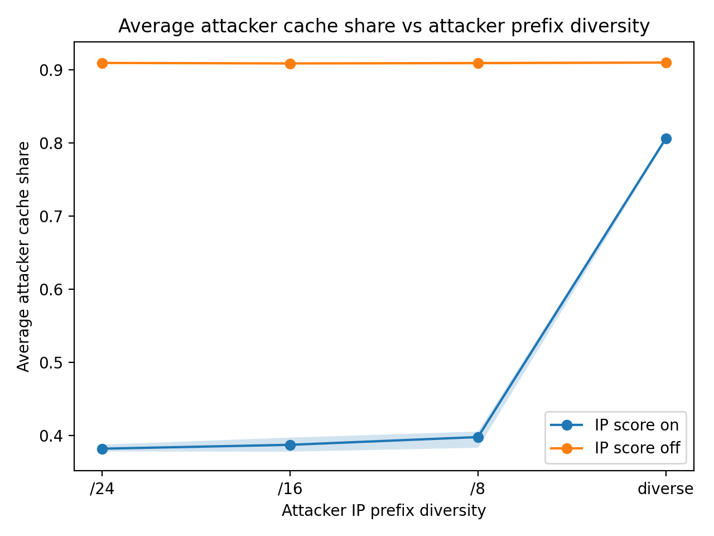
       
      <strong>Figure 9.</strong> Attacker cache share with IP scoring enabled and disabled under different attacker prefix assumptions.
    </td>
    <td align="center" width="50%">
      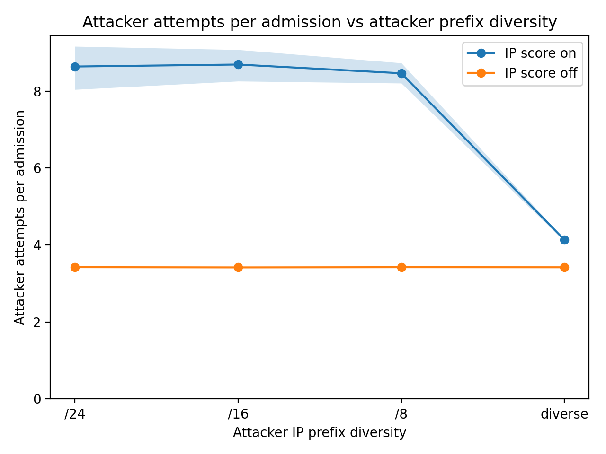
       
      <strong>Figure 10.</strong> Attacker attempts per admission with and without IP scoring. A ticket carries the waiting credit, so attempts stay between about 3 and 9 and no longer measure the attacker's cost.
    </td>
  </tr>
</table>

The IP score has a strong effect for prefix-concentrated attackers. For a `/24` attacker, where attacker IP addresses are drawn from the same `/24` prefix, attacker cache share is 38% with IP scoring enabled and 91% when IP scoring is disabled. The result is similar for `/16` (39%) and `/8` (40%) attackers in this configuration.

This similarity is due to how the IP score is computed. The registrar keeps a binary IP prefix tree over the IP addresses currently represented in the cache. For a candidate IP address, the score walks down the candidate's prefix path and checks whether each evaluated prefix bucket is already more populated than expected under a balanced distribution of cached IPs. The score only evaluates prefix levels while the expected balanced bucket occupancy is at least one. With about 335 ads in the cache in this experiment, it evaluates roughly the first 8 bits, so it captures coarse prefix concentration rather than distinguishing between `/8`, `/16`, and `/24` structure. All three attacker models sit inside one `/8` in this workload, so they receive the same IP-diversity penalties.

For a diverse attacker, the IP score no longer provides the same protection: attacker share is 81% even with IP scoring enabled, about the same as its share of requests.

The IP term also has a cost for honest advertisers, because real honest addresses are not spread evenly over the address space either. Without any attacker and with uniform topics, the cache is about 30% full; honest p95 delay is then 9,940 s with the IP score and 7,431 s without it, and 82% of honest registrations wait longer than 2E with the score against 49% without it. Under attack the honest delay is highest when the attacker is diverse: its addresses then look more diverse than the honest ones, and with the IP score on, honest starvation is 96% and the honest p95 is 31,722 s, against 77% and 18,663 s under the `/24` attacker. Turning the score off does not help honest advertisers in either case: about 43% of new honest requests are admitted within the run with the score off, against 65% under the diverse attacker and 84% under the `/24` attacker with it on. The lower p95 with the score off (about 10,000 s) counts only those that get in.

Disabling the IP score also harms honest advertisers in this experiment. The cache stays much fuller (84% average utilisation, against 34% with the score enabled), so the base time is far larger. A request for a topic that already holds an ad can then be quoted up to the 24 h cap, while a request for an empty topic pays only b · G. The attacker's 10,000 topics are almost always empty; the 300 honest topics often are not. In one seed, all 1,019 honest quotes at the 24 h cap were for a topic with an ad in the cache, and all 250 fresh honest admissions were for a topic with none. Only about 43% of new honest requests are admitted within the run with the IP score disabled, against 84% with it enabled.

The cost imposed on concentrated attackers shows up in waiting time rather than in attempts. Because a quote covers the whole remaining wait and the ticket carries the credit, an advertiser that waits out its quote needs few attempts: under the `/24` attack, attacker attempts per admission are 8.6 with IP scoring and 3.4 without it (Figure 10). The waiting time differs much more. The median attacker registration delay is 22,547 s with IP scoring and 5,604 s without it, and the p95 is 46,536 s against 10,472 s. The IP-diversity term therefore does more than reduce cache share: it multiplies the time a concentrated attacker must hold each pending registration open to obtain an admission.

## 8. Q4: Cost of topic similarity for popular honest topics

### 8.1 Why this question matters

The topic-similarity term is motivated by target-topic abuse: a registrar should not allow one topic to dominate its cache simply because many registration attempts are made for that topic. However, the same mechanism can also penalise legitimate popularity. If many honest advertisers belong to the same service topic, the topic-similarity term may delay them and under-represent that service at a single registrar.

This experiment therefore asks a different type of question from the attack experiments. It measures the benign cost of the topic-similarity term under no attack, with the fraction of honest registrations using the target topic varied over 0, 0.1, 0.25, 0.5, 0.75 and 0.9.

### 8.2 Results

<table>
  <tr>
    <td align="center" width="50%">
      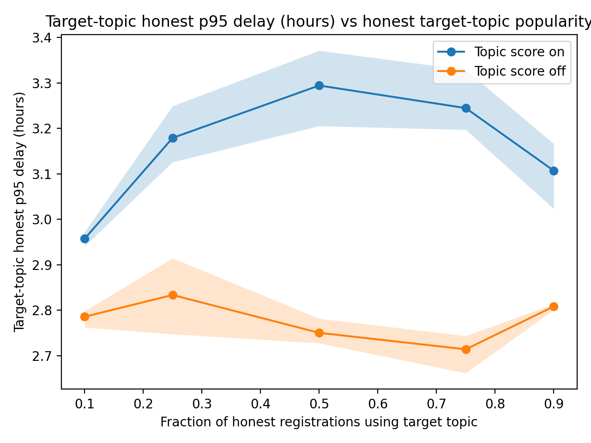
       
      <strong>Figure 11.</strong> Target-topic honest p95 delay as the fraction of honest target-topic demand increases.
    </td>
    <td align="center" width="50%">
      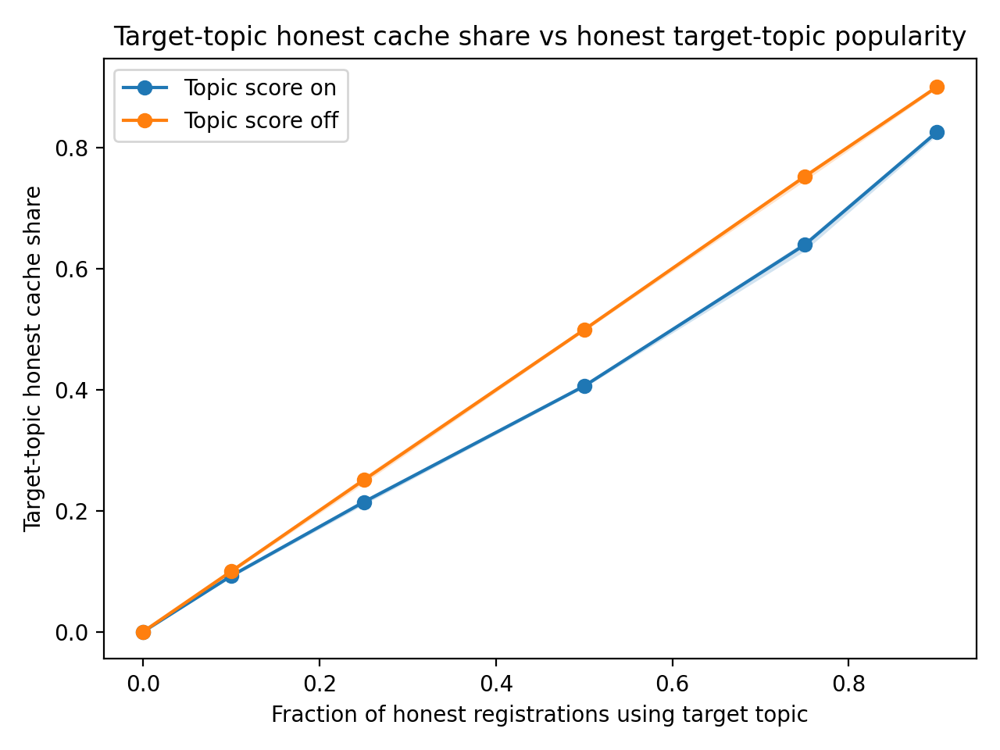
       
      <strong>Figure 12.</strong> Target-topic cache share as a function of honest target-topic demand.
    </td>
  </tr>
</table>

When topic scoring is enabled, target-topic honest registrations experience higher delay than with topic scoring disabled. At 90% target-topic demand, target-topic p95 delay is 11,186 s (3.1 h) with topic scoring enabled and 10,110 s (2.8 h) with topic scoring disabled; at 50% demand it is 11,860 s against 9,901 s. The delay with topic scoring enabled rises from 3.0 h at 10% demand to 3.3 h at 50%, and eases to 3.1 h at 90%. The cost is 18 to 33 minutes of p95 delay at 50% demand or more.

The cache-share result shows the mechanism's intended effect. With topic scoring enabled, target-topic cache share grows less than demand. At 90% target-topic demand, the target topic receives 83% of the cache, and at 50% demand it receives 41%. With topic scoring disabled, the cache share tracks demand; at 90% demand, the target topic receives 90% of the cache.

### 8.3 Implication for parameter choice

The topic-similarity term should be retained because it is essential for target-topic abuse resistance. However, it should be documented as a deliberate diversity trade-off. A registrar using topic similarity does not aim to mirror global topic popularity exactly. Instead, it deliberately limits the extent to which any one topic can dominate a local cache.

This is acceptable if discovery is expected to use multiple registrars and if popular services can be represented across the network rather than relying on unrestricted dominance at each registrar. In the evaluated workload, with the IP term on (the default), the benign cost is about 18 to 33 minutes of p95 delay and up to 11 percentage points of cache share for a topic used by half or more of the honest advertisers. Without the IP term the topic term costs much more, because the cache is fuller: at 50% demand the target-topic p95 is then 39,688 s (§5.4). With `Wbase = 0.1` and the `c + 1` term the popular-topic cost still holds and is of the same order as with the earlier registrar at the same `C`: 0.8 h and 11 points at 50% demand there, 0.5 h and 9 points here.

## 9. Q5: Robustness under increasing attack intensity

### 9.1 Why this question matters

Q1 varies the protocol parameter `Pocc`. Q5 fixes the protocol parameters and varies attacker intensity. The goal here is to examine whether the chosen default operating point degrades gracefully.

The experiments fix `Pocc = 10`, `C = 1000`, `E = 900s`, `Wbase = 0.1` and `G = 1e-7`, then vary the attacker registration rate over `0.02/s`, `0.05/s`, `0.1/s`, `0.2/s` and `0.4/s`, with honest rate fixed at `0.05/s`.

### 9.2 Cache-occupation attack

<table>
  <tr>
    <td align="center" width="50%">
      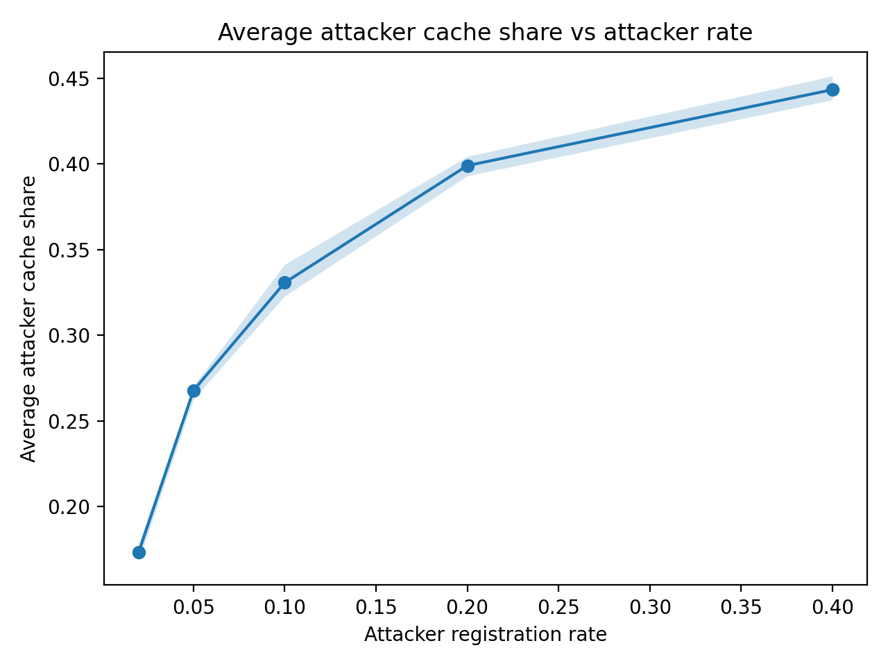
       
      <strong>Figure 13.</strong> Attacker cache share under increasing cache-occupation attack intensity.
    </td>
    <td align="center" width="50%">
      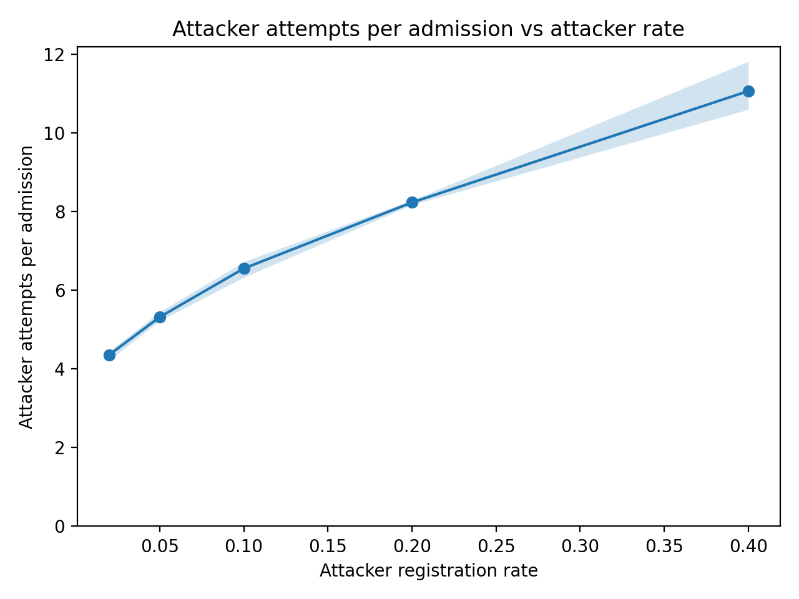
       
      <strong>Figure 14.</strong> Attacker attempts per admission under increasing cache-occupation attack intensity. A ticket carries the waiting credit, so attempts stay between about 4 and 11 and no longer measure the attacker's cost.
    </td>
  </tr>
</table>

Under cache occupation, attacker cache share increases with attacker rate, but less than proportionally. Attacker share is 17% at attacker rate `0.02/s`, 40% at `0.2/s`, and 44% at `0.4/s`. Without diversity penalties the attacker would hold its share of requests, which is 29%, 80% and 89% at those rates; admission control keeps it about 11 to 45 percentage points below that, with the gap widening as the attack grows.

The cost to the attacker rises with intensity. Attacker attempts per admission increase from 4.4 at `0.02/s` to 8.2 at `0.2/s` and 11.1 at `0.4/s`, while a ticket carries the waiting credit between attempts. The median attacker registration delay rises from 10,687 s at `0.02/s` to 23,542 s at `0.2/s` and 28,117 s at `0.4/s`. Honest p95 delay rises from 12,252 s to 18,636 s and 21,179 s over the same range. The mechanism therefore does not exclude the attacker, but each additional point of cache share costs the attacker more waiting time.

### 9.3 Target-topic attack

<table>
  <tr>
    <td align="center" width="50%">
      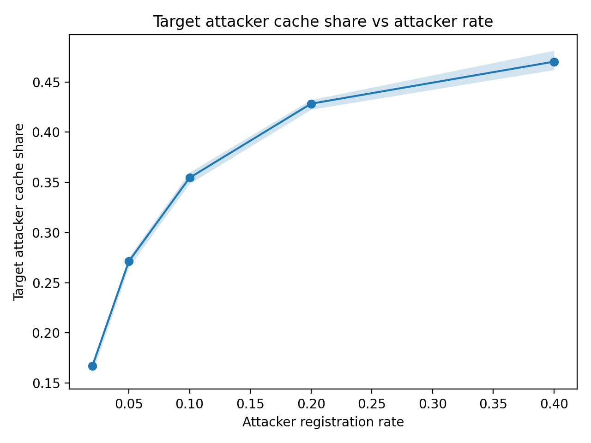
       
      <strong>Figure 15.</strong> Target-topic attacker cache share under increasing attack intensity.
    </td>
    <td align="center" width="50%">
      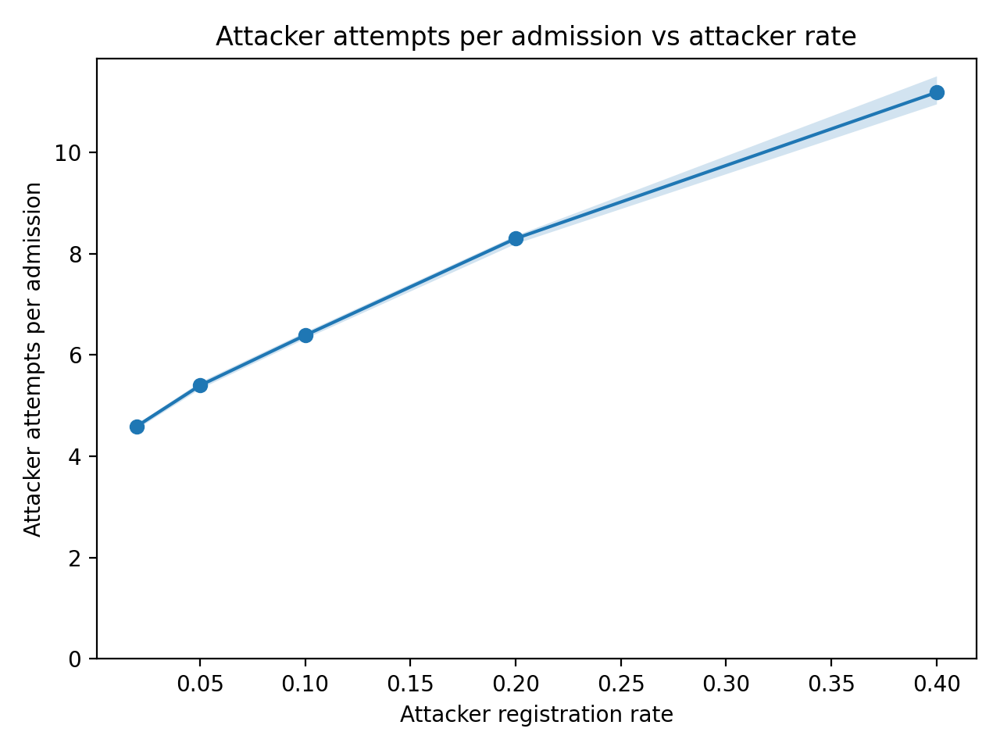
       
      <strong>Figure 16.</strong> Attacker attempts per admission under increasing target-topic attack intensity. A ticket carries the waiting credit, so attempts stay between about 4 and 11 and no longer measure the attacker's cost.
    </td>
  </tr>
</table>

Under the target-topic attack, target attacker share increases from 17% at attacker rate `0.02/s` to 43% at `0.2/s`, and 47% at `0.4/s`.

Attempts per admission rise from 4.6 at `0.02/s` to 8.3 at `0.2/s` and 11.2 at `0.4/s`, and the median attacker registration delay from 10,806 s to 24,187 s and 29,202 s.

### 9.4 Sensitivity: honest advertisers that give up

The results above assume that every advertiser waits out every quote. An honest client instead drops a registrar when a single quote, or its total waiting at that registrar, exceeds 1.5·E (1,350 s), and comes back after E as a new attempt. Rerunning the default cases with honest advertisers that give up, while attackers still wait out every quote, gives the rows marked "honest give-up". The rows marked "all give up" have attackers follow the same budget. Target-topic rows give, in brackets, the attackers' share of the target topic's ads.

| Case (`Pocc = 10`) | `C = 1000`: attacker cache share | `C = 1000`: new honest requests admitted | `C = 5000`: attacker cache share | `C = 5000`: new honest requests admitted |
|---|---:|---:|---:|---:|
| Cache occupation, waiting out quotes | 40% | 83% | 60% | 95% |
| Cache occupation, honest give-up | 49% | 60% | 72% | 66% |
| Cache occupation, all give up | 6% | 78% | 25% | 96% |
| Target topic, waiting out quotes | 43% (75%) | 77% | 61% (83%) | 93% |
| Target topic, honest give-up | 57% (98%) | 37% | 72% (97%) | 50% |
| Target topic, all give up | 5% (9%) | 69% | 20% (29%) | 88% |
| No attack, 50% target demand, honest give-up | n/a | 70% | n/a | 89% |

An attacker that is willing to wait therefore gains 9 to 14 percentage points of the cache when honest advertisers follow the client's budget. An attacker that follows the budget itself does much worse: on a crowded prefix, b · score exceeds 1,350 s, so its requests keep giving up. These numbers describe one registrar only. In the network an honest advertiser that gives up here registers with other registrars, so the drop in honest admissions overstates the loss of discoverability; the rise in attacker share at a registrar under attack is the part that carries over.

### 9.5 Implication for parameter choice

These results support interpreting admission control as a cost-imposition mechanism rather than an absolute exclusion mechanism. Increasing attacker rate still increases attacker cache share, but the attacker's share stays well below its share of requests and its waiting time per admission grows. The default operating point degrades gracefully under stronger attack intensity rather than giving immediate cache capture. At `C = 1000` and `Pocc = 10`, however, an attacker with four times the honest request rate already holds 40% of a registrar's cache, and honest p95 delay is 5.2 h.

## 10. Recommended parameter values

The table gives the current values and what the experiments say about each. `C = 1000` follows from the network-level comparison in §6.4. None of the other values was changed by this evaluation.

| Component | Value | What the data support |
|---|---:|---|
| Advertisement lifetime `E` | `900s` | Not varied here. Provides a bounded cache residency interval and defines the natural expiry cycle used by the registrar and the client's 1.5·E budget. |
| Cache capacity `C` | `1000` | A trade-off, not an optimum, and chosen at network level (§6.4). Under cache occupation at `C = 1000`, attackers hold 40% of the cache (49% with the client's give-up budget), honest p95 delay is 5.2 h, and 83% of new honest requests are admitted when they wait out their quotes (60% with the give-up budget). At `C = 5000` attackers hold 60% (72%), the p95 is 1.6 h and 95% are admitted (66%). At a single registrar `C = 1000` is better on attacker share and `C = 5000` on every honest measure, also without an attacker. |
| Occupancy exponent `Pocc` | `10` | Not singled out by the data. From 6 to 16, attacker share falls 7 points while utilisation falls 23 points and honest delay rises 2.0 h. `Pocc = 1` does better at `C = 1000` under cache occupation (attacker share 33% against 40%, utilisation 84% against 34%, honest p95 2.3 h against 5.2 h) and on honest delay under the target-topic attack (4.1 h against 7.6 h), with a 2-point higher attacker share there; it was tested at one registrar only, with advertisers that wait out their quotes. |
| Base-time scale `Wbase` | `0.1` | Not varied here. |
| Safety constant `G` | `1e-7` | Not varied here. b · G is the whole wait for a request on an empty topic from an uncrowded prefix, so it sets how fast such requests are admitted as occupancy grows. |
| IP-diversity term | on | Keep, with its cost stated. Against concentrated attackers it lowers the attacker share from 91% to 38% and raises their median wait fourfold. It does not penalise diverse attackers, who keep their 80% request share; with the attacker on 10,000 topics it still keeps 65 to 84% of new honest requests admitted, against about 43% without it. Its honest cost, because real addresses are unevenly spread: without an attack and with uniform topics, honest p95 delay is 9,940 s with the score against 7,431 s without it, and 82% of honest registrations wait longer than 2E against 49%. |
| Topic-similarity term | on | Keep. With the IP term on, its benign cost for a popular honest topic is 18 to 33 minutes of p95 delay and up to 11 points of cache share. |

The central rationale is that the default setting should prioritise cache diversity and abuse resistance while preserving usable, though not maximal, cache utilisation. `Pocc = 10` and `C = 1000` are pragmatic defaults rather than universal optima: the single-registrar data do not show either to be the best value for the evaluated workload, and deployments with different resource constraints or threat models may tune them differently.

## 11. Summary

The experiments show that admission-control parameter choices cannot be justified by cache utilisation alone. Under abuse, the relevant question is the composition of the cache and the cost imposed on attackers.

The occupancy exponent `Pocc` controls how aggressively the registrar reacts to cache pressure. From `Pocc = 4` upwards, increasing `Pocc` reduces attacker cache share but increases honest delay and reduces utilisation, with no value that stands out. `Pocc = 10` is a middle point of that range, but `Pocc = 1` does better on most measures at `C = 1000`, so these results do not establish 10 over lower values.

The cache capacity `C` controls the amount of registrar-local storage. Larger caches reduce honest delay but allow greater attacker representation. At `C = 1000` and under cache occupation, 83% of new honest requests are admitted within the run, with a p95 delay of 5.2 h, when honest advertisers wait out their quotes; with the client's give-up budget the figure is 60% (37% under the target-topic attack). An attacker with four times the honest request rate holds 40% of the cache, or 49% when honest advertisers give up. At `C = 5000` the same figures are 95%, 1.6 h, 66%, 50%, 60% and 72%. A larger cache is better for honest advertisers and a smaller one for limiting the attacker's share; `C = 1000` follows from the network-level comparison in §6.4, not from these single-registrar results.

The diversity terms are necessary. Occupancy-only admission cannot prevent attacker dominance. IP-diversity scoring is especially effective against concentrated-prefix attackers, while topic similarity protects against target-topic flooding. Both terms therefore serve a security purpose. Both also cost honest advertisers: without an attack and with uniform topics, the honest p95 delay is 9,940 s with both terms and 3,343 s with neither (§5.4), and with the IP term on, topic similarity adds 18 to 33 minutes for legitimately popular topics.

Overall, the recommended parameters favour registrar-local diversity, bounded cache occupation, and increased attacker cost while maintaining usable admission behaviour for honest advertisers. The evaluation covers a single registrar; how these per-registrar results combine across the registrars an advertiser uses is outside its scope.
